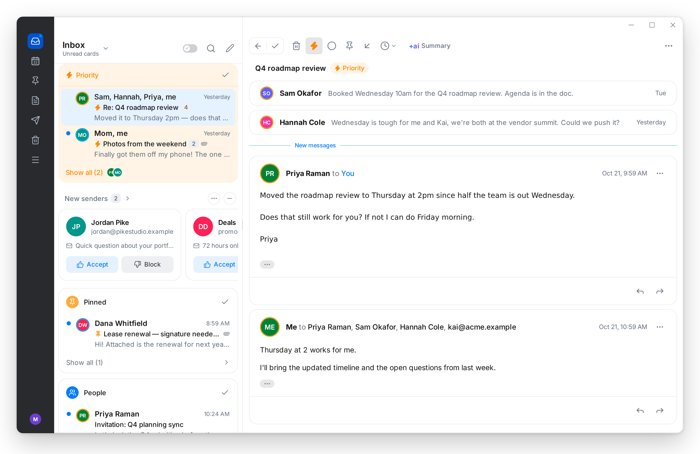
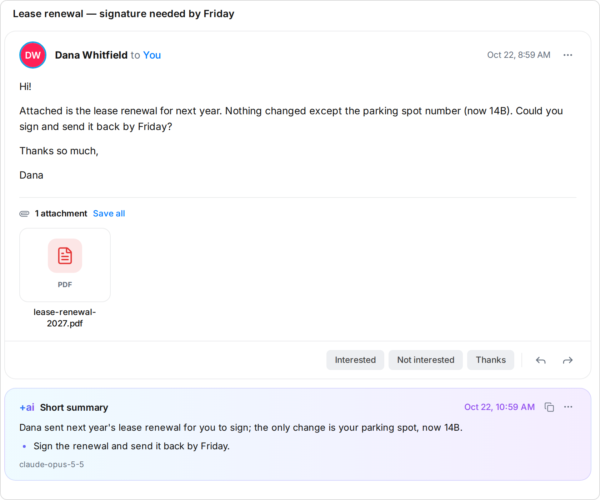
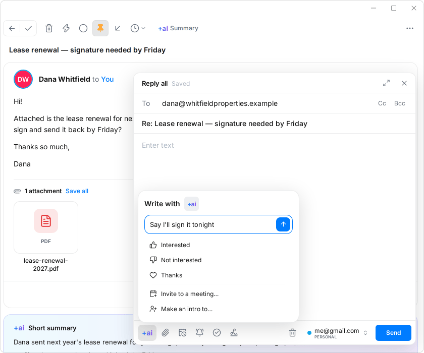
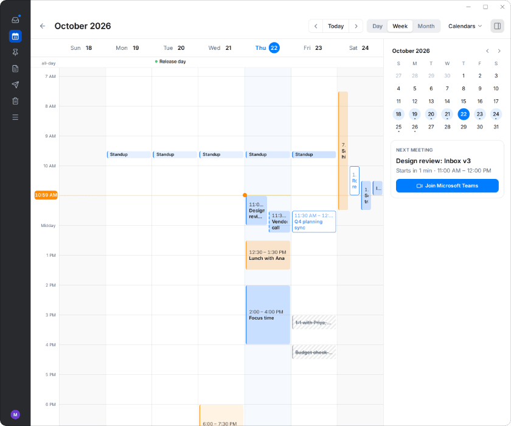
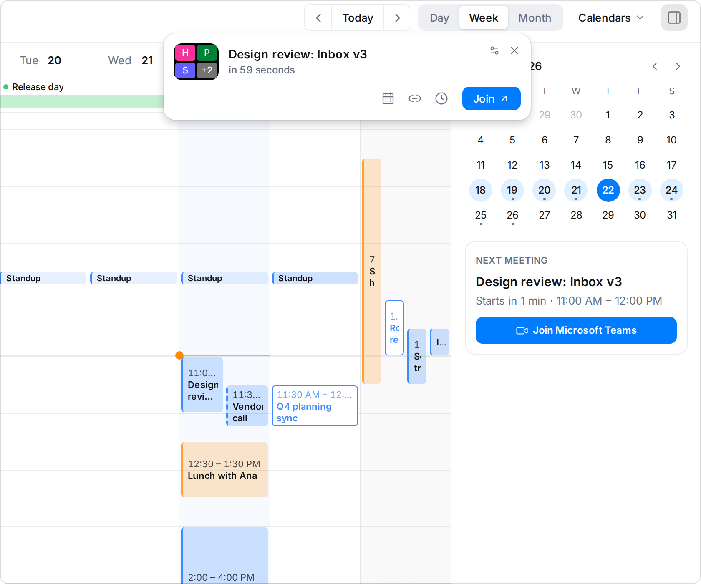
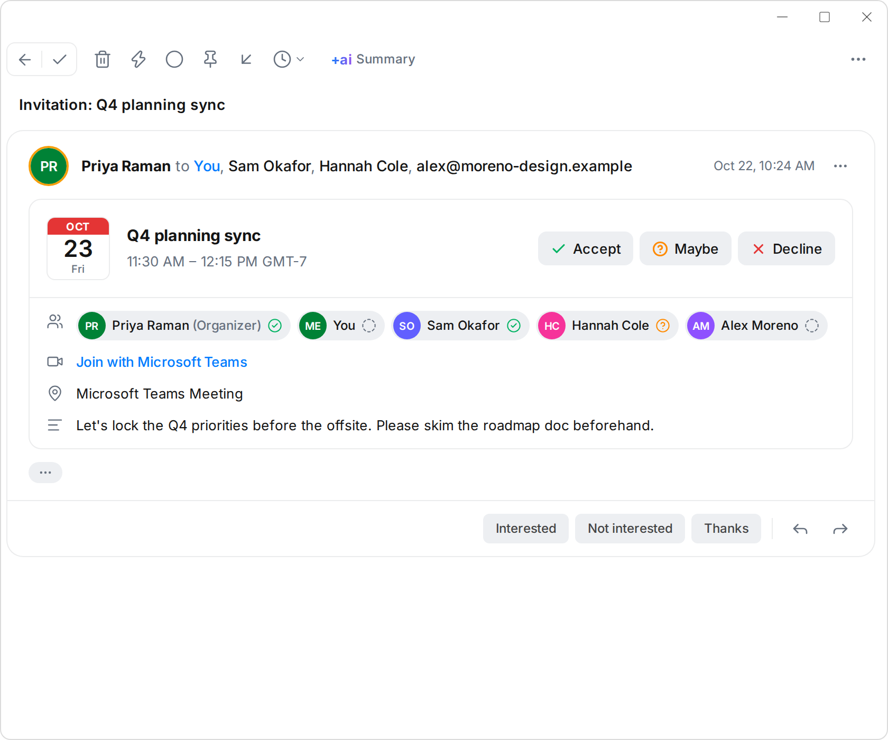
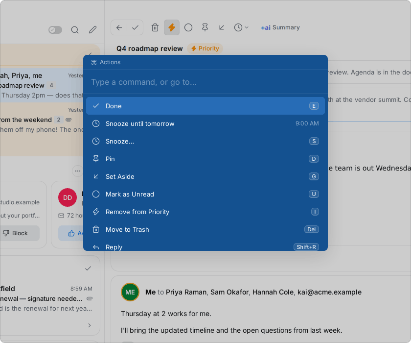

<div align="center">


# spark-rs

**Spark-style email for Windows, with a Rust core and AI on your own key.**

[](https://github.com/Trillx/spark-rs/releases/latest)
[](https://github.com/Trillx/spark-rs/releases/latest)
[](https://v2.tauri.app)

[](https://git.cafe/michael/spark-rs/blob/main/LICENSE)

</div>

<br>

<picture>
  <source media="(prefers-color-scheme: dark)" srcset="assets/screenshots/inbox-dark.png">
  
</picture>

<p align="center"><sub>Screenshots show the demo mailbox that spark-rs opens with until you add an account. The demo doesn't call an AI provider, so the +AI summary in them was written by hand.</sub></p>

spark-rs is a desktop email client modeled on Spark: the Smart Inbox, the
Gatekeeper for new senders, pins, snooze, Set Aside, the single-key shortcuts
and the +AI tools, rebuilt as a Windows app with a Rust core. Windows on ARM
(`aarch64-pc-windows-msvc`) was the first target, and Windows x64 works too.

It differs from Spark on purpose in a few places. AI runs on your own
Anthropic, OpenAI or OpenAI-compatible account. There's no sync server: the
app talks to your mail servers itself, so snooze, Set Aside, Priority and
new-sender screening stay on the computer you set them on. Gmail signs in with
an app password. Nothing goes through spark-rs's servers, because there aren't
any.

Created in [T3 Code](https://t3.codes).

## Features

- **Smart Inbox.** Priority, Pins, People, Notifications and Newsletters as
  cards, or as one focused list. Mail from new senders waits in the
  Gatekeeper until you accept or block the sender, once for all your
  accounts. Colleagues at your work domain, people you've written to (from
  any app: spark-rs checks Sent), and a few big companies' notifications
  skip it. A blocked sender's mail goes to a Blocked folder on the server,
  as in Spark, so it leaves the inbox on your phone and in webmail too.
  Settings → Gatekeeper screens new senders before the Inbox (the default),
  inside it (the email asks when you open it), or not at all. An email's
  Accept and Block menus, the Command Center and Spark's shortcuts (Ctrl+T
  accepts, Ctrl+B blocks, E accepts and marks Done) also take a whole domain.
- **Priority.** Priority conversations stay on top of the Inbox until
  they're Done. Make a sender Priority and all their mail is, the emails
  you have and the ones still to come; notifications can be just for
  Priority mail.
- **Work and personal mail together.** Microsoft 365 through Microsoft Graph,
  Gmail with an app password, and any IMAP server, in one inbox.
- **Fast triage.** Done, snooze, pin, Set Aside and Priority on single keys,
  Ctrl+K for every command, and six seconds to undo Done, Delete or a move
  before the server sees it.
- **+AI on your own key.** Summaries, quick replies, and writing and rewriting
  in the composer, through Anthropic, OpenAI, or an OpenAI-compatible server
  such as Ollama on your own computer. The AI Assistant answers questions
  about your mail and calendar and tidies the inbox when you ask. Turn on
  Auto-Labels and Auto-Drafts and new mail is sorted under To respond, FYI
  and the like, with replies waiting in Drafts for the mail that needs one.
- **Calendar.** Microsoft 365 calendars by day, week or month, invitations you
  answer from the email, event alerts with Snooze, and a pop-up before
  meetings, with Join for Teams, Zoom and Meet calls.
- **Search.** A full-text index on your computer answers as you type, and the
  servers are searched too, for mail that isn't downloaded yet.
- **Agents.** Claude Code, Codex and other MCP clients can read, triage or
  send your mail through `spark-cli`, as far as you allow for each account.
- **Native on Windows.** Builds for ARM and x64, about 12 MB to download, with
  the tray, notifications, and drafts that save offline. Passwords and keys
  stay in Windows Credential Manager.

[spark-rs and Spark, feature by feature](https://git.cafe/michael/spark-rs/blob/main/FEATURES.md)
goes through every feature on Spark's pricing page and shows which ones
spark-rs has, has in part, or doesn't have yet.

<table>
  <tr>
    <td width="50%" valign="top">
      <b>+AI Summary</b><br>
      <sub>Short, detailed or action points, from your own AI provider.</sub><br><br>
      <picture>
        <source media="(prefers-color-scheme: dark)" srcset="assets/screenshots/ai-summary-dark.png">
        
      </picture>
    </td>
    <td width="50%" valign="top">
      <b>Write with +AI</b><br>
      <sub>Describe the email, pick a quick reply, or have your draft rewritten.</sub><br><br>
      <picture>
        <source media="(prefers-color-scheme: dark)" srcset="assets/screenshots/ai-compose-dark.png">
        
      </picture>
    </td>
  </tr>
  <tr>
    <td width="50%" valign="top">
      <b>Calendar</b><br>
      <sub>Day, week or month, with the next meeting and its Join button.</sub><br><br>
      <picture>
        <source media="(prefers-color-scheme: dark)" srcset="assets/screenshots/calendar-dark.png">
        
      </picture>
    </td>
    <td width="50%" valign="top">
      <b>Meeting pop-up</b><br>
      <sub>A minute before each meeting, over your other windows.</sub><br><br>
      <picture>
        <source media="(prefers-color-scheme: dark)" srcset="assets/screenshots/meeting-popup-dark.png">
        
      </picture>
    </td>
  </tr>
  <tr>
    <td width="50%" valign="top">
      <b>Invitations</b><br>
      <sub>Accept, Maybe or Decline from the email, with who's coming.</sub><br><br>
      <picture>
        <source media="(prefers-color-scheme: dark)" srcset="assets/screenshots/invite-dark.png">
        
      </picture>
    </td>
    <td width="50%" valign="top">
      <b>Command center</b><br>
      <sub>Ctrl+K for every action, with its single-key shortcut.</sub><br><br>
      <picture>
        <source media="(prefers-color-scheme: dark)" srcset="assets/screenshots/command-dark.png">
        
      </picture>
    </td>
  </tr>
</table>

## Download

Download the latest installer from the
[GitHub mirror](https://github.com/Trillx/spark-rs/releases/latest).
Choose `windows-arm64-setup.exe` for Windows on ARM or
`windows-x64-setup.exe` for Intel and AMD. The installer puts spark-rs and
spark-cli together in `%LOCALAPPDATA%\spark-rs` by default, creates a Start
menu shortcut, and offers desktop and Run shortcuts. It doesn't need admin
rights or change PATH. Open Settings → Accounts to add your first account.

spark-rs isn't Authenticode-signed. SmartScreen may show a warning: choose
**More info → Run anyway** if you trust the download. Windows 11's **Smart
App Control** can block unsigned apps, including their updates, outright.
It must be off for this unsigned build to run; check Windows Security → App
& browser control before downloading. A managed work PC may also block
apps installed in your user folder; ask your administrator about its policy.
The updater uses a separate signature to verify downloads from this project.

Moving from a zip copy: quit it completely, including its tray icon, run the
installer, then delete the old extracted folder. Your mail and settings carry
over. Re-copy agent commands from Settings → Agents so they use the installed
`spark-cli.exe`. A running zip copy can intercept a new copy's launch.

### Updates

Installed copies check for completed builds from `main` on start and every
four hours. A dot on Settings means an update is waiting. Settings → About
shows the version, build, commit, how many **commits behind** you are, and the
newest commit subjects. That count includes only app-changing commits in the
newest finished build, so documentation changes and unfinished builds don't
increase it. The last check remains visible offline.

Choose **Update and restart**, confirm, and let the download finish. The
installer replaces the app and CLI and restarts spark-rs. Agents already
using spark-cli stay connected: their requests wait for the new app, and
they get the new CLI the next time they start it. Updates keep your mail,
settings and saved passwords. Nothing installs until you choose it. Copies
built locally can't update themselves.

Uninstalling keeps mail and saved passwords by default. Select **Also delete
my mail data and saved passwords** in the uninstaller to remove them too.

## Accounts

Settings (`Ctrl+,`) → Accounts → Add an account. Until the first account is
added the app shows a demo mailbox.

Mail is stored in `mail.sqlite` in the app's local data folder
(`%LOCALAPPDATA%\dev.sparkrs.desktop` on Windows). Passwords and Microsoft
sign-ins are kept in Windows Credential Manager under `spark-rs`, never in
files. Removing an account deletes its local mail and saved sign-in; nothing
is deleted on the server.

**Gmail.** Google requires an app password for mail apps: turn on 2-Step
Verification, create one at <https://myaccount.google.com/apppasswords>, then
choose **Gmail** and enter your address and the 16 letters. spark-rs uses
`imap.gmail.com:993` and `smtp.gmail.com:465` and checks the login before
saving.

**Microsoft 365 (work or school).** This needs an app registration in your
organization's Microsoft Entra tenant (<https://entra.microsoft.com> → App
registrations → New registration). If you can't register apps, ask IT:

- Supported account types: this organizational directory only.
- Platform: **Mobile and desktop applications**, redirect URI
  `http://localhost` (any port matches; spark-rs picks a free one).
- API permissions, Microsoft Graph, delegated: `User.Read`,
  `Mail.ReadWrite`, `Mail.Send`, `Calendars.ReadWrite`, `offline_access`. If
  your tenant requires admin consent, IT has to grant it.
- No client secret: desktop apps are public clients.

Then choose **Microsoft 365** and enter the Application (client) ID and the
Directory (tenant) ID, or your domain such as `contoso.onmicrosoft.com`.
Your browser opens Microsoft's sign-in; when it's done the account appears.
Check your company's rules first: using your own mail client on work mail may
not be allowed, and neither may AI (see AI below).

**Other IMAP servers.** Choose **Other (IMAP)** and enter the servers. Ports
993 and 465 use TLS from the start; 143 and 587 use STARTTLS.

What syncs: the inbox (the newest 300 messages on Gmail/IMAP, the last 30
days on Microsoft 365), checked every two minutes and on demand. Scrolling
to the end of a list brings in older mail, 100 messages at a time (on
Microsoft 365, mail from before the first 30 days doesn't pick up changes
made in other apps, such as being read or moved). Done,
Delete, read and pinned go back to the server after the 6-second undo
window; Done archives (All Mail on Gmail). Snooze, Set Aside, Priority and
new-sender screening stay on this computer.

On IMAP servers, moving mail requires MOVE or UIDPLUS, and removing old
server drafts requires UIDPLUS. The app reports an error when safe removal
isn't supported.

Closing the composer saves the message to the account's Drafts folder
(it's also saved as you type), on this computer at once and on the server
with the next sync, so it works offline. Opening a draft from Drafts edits
it; sending it or Delete Draft removes it from the server too, and undoing
the send keeps it. If a send is permanently rejected, its latest content and
copied files return to Drafts. Sent and Drafts list who the mail is to.

A Send Later choice stays with a saved draft on this computer, including
after a restart or server sync. Click Schedule to queue it for delivery.
Reply and Reply All use the message's Reply-To addresses when present and
leave your own account out of the recipients.

The composer writes rich text, as Spark's does. Select some text for the
formatting bar (bold, italic, underline, strikethrough, link, text and
highlight color, lists, quote, indent, heading, font and size), or use
Spark's shortcuts, such as Ctrl+Shift+8 for a bulleted list and Ctrl+Shift+K
for a link. Ctrl+Shift+V pastes without the formatting. Pictures pasted or
dropped on what you're writing go in it, and the Image Size button under it
makes them Small, Medium or Large. Typing @ and a name links the person and
adds them to To; Undo takes them off again. A reply quotes the original
with its formatting.

Templates are in Settings → Templates, and the template button in the
composer (or Ctrl+Shift+T) puts one in, under Recent once you've used it.
Placeholders fill in the first recipient's name and yours; a custom one
stays highlighted until you click it and type, and Send asks first if any
are left. "Create a New Template from draft" starts one from what you're
writing. Settings → Composer → Attachments with Replies makes replies take
the original's files always, never, or when you say so.

Make Default under Settings → Composer → Default email app registers
spark-rs as an email app, and Windows' Default apps opens for you to choose
it. Email links (`mailto:`) then start a new email in spark-rs, with the
addresses, subject and text they carry.

Signatures are in Settings → Signatures, where you write them or paste one
in (or edit the HTML). Each address starts new mail with its default: Most
recent (the signature last sent from it), No signature, or a particular one.
A reply takes the signature you used last in that conversation. In the
composer the signature sits under what you write and above the email you're
replying to or forwarding: the arrows at its left switch to another one or
hide it, and you can change it for that one email. Mail from the composer
goes out as HTML as well as plain text, with its pictures and the
signature's in the email.
Agents' email gets the account's signature too, unless they leave it off.

Attachments download as you open an email (Settings → Appearance →
Auto-download attachments; off, when you open or save one), also from
archived mail, and stay on this computer so they open at once next time:
up to 1 GB, the least recently used going first, and an account's going
with it.
Program files (`.exe`, `.js`, `.lnk` and the like) ask first, as Spark's do
("Open Anyway"), and downloaded files are marked as coming from the
internet, so Windows checks them and Office opens them in Protected View. Attach files with the paperclip,
Ctrl+Shift+A in the composer, or by dropping them on the window (pictures
dropped on the message itself go in it); forwards keep
the original's attachments. Messages over 10 MB are stored without their body
or file list.

Links in email open in your browser; `mailto:` links start a new email in
spark-rs. A link to another app (`zoommtg:`, `slack:`) asks first, and
script and file links (`javascript:`, `file:`) never open.

Ctrl+Shift+F (or Find in Conversation in the ⋯ menu) searches the open
conversation's emails, with Enter for the next match. The ⋯ menu also prints
the conversation, and each email's own ⋯ prints it, saves it as an .eml file,
copies it as Markdown, or copies everyone's addresses. Windows' print dialog
saves as PDF too (Microsoft Print to PDF).

Ctrl+Alt+N (or Open in a New Window in the ⋯ menu) opens the conversation in
a window of its own, which closes with Esc or once you're done with it.
With Settings → Appearance → Always open conversations in a new window, the
one-column layout does that for every conversation you open. Read to its
end, a conversation scrolls to a new email as it arrives.

Calendar invitations show as a card in place of the email: the date and time
in your time zone, who's invited and how they answered, the call to join,
the place and the description. Accept, Maybe or Decline emails your answer to
the organizer at once (there's no undo window), and Change lets you pick
another. Replies and cancellations show as a banner over the event. The email
itself is behind the ⋯ button under the card. Answering doesn't change your
own calendar: on Microsoft 365, Outlook keeps showing the meeting as tentative.

## Calendar

The Calendar button in the sidebar (it shows today's date) opens your
Microsoft 365 calendars in Day, Week or Month view, with the calendars you
pick under Calendars. Clicking an event shows its details, a Join button for
Teams, Zoom or Meet calls, and Yes / Maybe / No, which answers it in your
calendar and tells the organizer. The calendar is read from Microsoft when you
open it, every five minutes while it's open, and as you move to other weeks;
what was read stays on this computer, so it opens at once.

New event (Ctrl+E) opens Spark's editor: the calendar, title, all day or
the times, how it repeats (every day, week, month or year, or a custom rule,
ending never, after some times or on a date), an alert, free or busy, a
Teams call, the people to invite, the place and a note. An event of your own
shows Edit and Delete in its details; for a repeating event they ask whether
to change only that occurrence, all of them, or it and those after it. Saving writes to your Microsoft 365 calendar at once, and Outlook
mails the invitations and updates. Settings → Calendar has the length and
alerts new events start with.

On the grid, drag across empty time (or double-click it) for a new event
there; drag your own events to move them, by their top or bottom edge to
change their length, or into the all-day row and out of it. In Month view
they move to another day. Right-click an event for Edit, Duplicate, Copy,
Delete, your answer to an invitation and Show only this calendar, and
empty time for New Event and Paste Event. Gmail calendars aren't there yet.

Microsoft 365 accounts added before the calendar arrived signed in without
the calendar permission: add `Calendars.ReadWrite` to the app registration
(see above), then choose Sign in on the calendar screen.

At each event's alert time (the reminder Outlook has for it), a Windows
notification says what starts and when, such as "Starts in 15 minutes at
10:00 AM". Snooze puts it off for 5, 10 or 30 minutes, and clicking it opens
the event in the calendar. An alert missed while spark-rs was closed or the
computer was asleep isn't shown late. Settings → Notifications → Calendar →
Event alerts turns them off.

A minute before each meeting, unless you pick another time, a pop-up shows at
the top of the screen, over your other windows, with a soft chime: who's in it, the time to go (then the time left), and
Join, which opens the call. Its other buttons open the meeting in the calendar,
copy the call link, snooze it for a minute and dismiss it; drag it to move it.
It stays until the meeting ends unless you dismiss it; once you've joined,
Join turns into a button that opens the call again. Your own Microsoft 365
calendars pop up and alert, not the ones others share with you, and the pop-up
leaves out declined, canceled and all-day events, and by default events that
have no one else and no call link, like focus time. To catch meetings added
since you last looked, spark-rs reads the next two hours of your calendar every
five minutes, and the next two weeks every hour. Settings → Notifications →
Meeting pop-up sets when it shows (as the meeting starts, or 1, 2, 3, 5, 10 or
15 minutes before) or turns it off, turns its chime off and shows a sample.

## Notifications and the tray

Closing the window leaves spark-rs running in the notification area, still
syncing; click its icon to bring the window back, or right-click it to check
for mail or quit. New mail shows a Windows notification with the New Mail
sound, and clicking one opens the message. By default only mail from people
notifies (Spark's smart notifications); newsletters, notifications, mail from
new senders waiting in the Gatekeeper, and an account's first sync stay
quiet, as does anything arriving while the window is in front. Settings →
Notifications changes this (to all mail, or only Priority mail), turns the
sound off, stops closing to the tray, or opens spark-rs in the background
when you sign in to Windows.

Starting spark-rs again while it runs brings the running window forward.

## Sidebar and folders

The sidebar starts as a narrow strip of icons. `/` or the ≡ button opens it
over the list, and Lock Sidebar keeps it open. Right under the Inbox is a top
section (Pins, Drafts, Sent, Trash at first), then Folders. Only the top
section shows in the narrow strip.

More opens every list you can add: shared lists like Snoozed, Spam, Blocked
and Recently Seen, smart folders (saved searches), and each account's own
folders and Gmail labels. Clicking one opens it and keeps it under Recents;
Ctrl-click or the star adds it to the sidebar. Right-click a sidebar entry to
move it to the top, hide its counter, color it, or rename or delete a folder.
The + buttons create folders on the server, and the search field's Save
button turns a search into a smart folder.

Drag entries in the open sidebar to reorder them or move them between the top
section and Folders; Recents can be dragged into either. Drag an email from
the list onto a folder (of its own account) to move it there, or onto Inbox,
Archive, Trash or Pins; this works on the narrow strip's icons too, and Undo
puts it back. With more than one account, the Inbox and the shared lists
(Sent, Drafts, Archive, Trash, Spam, Snoozed, Pins…) expand into a row per
account that shows just that account's mail.

Moving an email to a folder moves it on the server once the undo window
passes. On Gmail, folders are labels: moving between them swaps the labels,
and the email keeps its other labels.

A folder shows its newest 200 messages, and 100 more each time you scroll
to the end. Folders in the sidebar stay in sync, as does the one that's
open; others are fetched when opened.

## Search

Ctrl+F opens the search field at the top of the list. spark-rs keeps a
full-text index of the mail it has stored (senders, recipients, subjects and
text), so a search finds words anywhere in a message, ignoring case and
accents. Each word matches the start of a word ("invo" finds "Invoice"),
"quoted words" have to appear together, and `from:`, `has:attachment`,
`is:unread` and `date:today` narrow the results, newest first.

Results from this computer show at once. A second after you stop typing, the
search also goes to every account's server, as in Spark, for mail spark-rs
hasn't fetched yet: Microsoft 365 through Graph's `$search`, Gmail in its own
search syntax, and other IMAP servers with `SEARCH`. Up to 100 of the newest
hits per place are fetched and stored, so they show in the results and are
found locally from then on. Gmail and IMAP search the inbox and the archive
folder; Microsoft 365 searches every folder except Deleted Items, Junk Email
and Drafts. Searches with only filters, or for today's mail, stay local.

## AI

The +AI features use your own AI provider, set up in Settings → AI:

- **Anthropic** (Claude) or **OpenAI**: enter your API key and the model.
  Anthropic starts with Claude Opus 5.5.
- **Custom**, for any server with the OpenAI Chat Completions API: enter its
  base URL, such as `http://localhost:11434/v1` for Ollama on your own
  computer, and the model. The key is optional, since local servers usually
  don't need one.

Test connection checks the key and the base URL by loading the provider's
models, which the Model field then suggests. It doesn't try the model itself,
so a misspelled model name shows up only when you first use +AI. The key is
kept in Windows Credential Manager, not in a settings file.

- **+AI Summary** in the toolbar puts a summary under the email: Short
  (`Ctrl+Shift+S`), Detailed (`Ctrl+Shift+D`) or Action Points
  (`Ctrl+Shift+A`; in the composer it attaches files instead).
- **Quick replies** (Interested, Not interested, Thanks) start a reply that AI
  writes. They're under the latest email in a conversation when it's from a
  person rather than a newsletter or notification, isn't one you sent, and
  isn't waiting in the Gatekeeper.
- **+AI in the composer** writes an email from a few words, or rephrases,
  shortens, expands or proofreads what you've written, changes its tone, or
  changes it the way you describe.

### AI Assistant

**Ask me anything...** at the bottom right of the mail (or `Ctrl+Shift+C`, or
AI Assistant in `Ctrl+K`) opens a chat beside your mail. Hover over the button
for a few questions to start with. The assistant searches and reads your
email and looks at your calendar to answer. Each email it relies on is a
small number in the answer, listed under Sources, and clicking one opens
that email. "This email" means the one open in the reader.

Ask it to tidy up and it proposes the change on a card: mark emails Done,
snooze, pin, set aside or delete them, or accept or block senders. Nothing
changes until you click Approve. When it writes an email or a reply, it
shows a draft with **Open Draft**, which opens it in the composer for you to
edit and send. The assistant can't send email itself.

Stop ends an answer early. **Start new chat** clears the panel, and **View
past chats** brings back an earlier chat, which you can continue or delete.
Chats are saved on your computer; the 50 most recent are kept.

### Auto-Labels and Auto-Drafts

Settings → Inbox Automation turns these on for each account. Both are off
until you do.

- **Auto-Labels** give each new Inbox email one of Spark's labels: To
  respond, FYI, Comment, Notification, Meeting update, Actioned, Marketing or
  News. The label shows on the email, each label has a list you can keep in
  the sidebar, and you can change or remove it from the conversation. Gmail
  gets them as Gmail labels and Microsoft 365 as Outlook categories, so they
  show in your other mail apps too; other IMAP servers keep them in spark-rs
  only. When you turn Auto-Labels on, the past week's mail is labeled too.
  Replying to a To respond conversation makes it Actioned.
- **Auto-Drafts** write a reply to new mail that needs one. It waits in
  Drafts and under the email, signed with your signature, and nothing is
  sent until you send it. When an email asks you to choose, such as yes or no
  or one time or another, there are up to three replies to pick from. Custom
  instructions change how drafts are written, senders you list never get one,
  and drafts you don't touch are deleted after 7 days (you can change this).
  Senders waiting in the Gatekeeper get none unless you turn that on. Any
  email's menu has **Auto-Draft a Reply** to get one on request.

Sorting runs on every new email, so you can give inbox automation a smaller,
cheaper model than the one in Settings → AI.

Your provider gets only what you use AI on, under its terms. A summary sends
the email's sender, date, subject and text. The composer sends what you ask
for, the draft or the part you selected, the email you're replying to or
forwarding, and, when no signature follows, your name for the sign-off.
The AI Assistant sends your question, the date and time, the subject and
sender of the email open in the reader, and what its tools find while it
answers: the sender, subject, date and snippet of emails it searches or lists,
the full text of emails it reads, and your calendar events for the days it
checks. The rest of a chat goes too when you continue it.
Nothing is sent in the background unless you turn on Inbox Automation: then
each new Inbox email in those accounts is sent (sender, recipients, date,
subject and text, a few at a time), and for a draft, the earlier emails of
its conversation, your instructions and your name. Check your employer's
policy before using AI on work mail.

## AI agents

Agents on this computer, such as Claude Code, Codex and Hermes, can work
with your mail through `spark-cli`, which they run as an MCP server
(`spark-cli mcp`). They see nothing until you choose what they may do in each
account under Settings → Agents:

- **Read**: list, search and read mail.
- **Triage**: also mark mail Done, read, pinned, set aside, snoozed or deleted.
  Changes reach the server after the usual undo window. With triage in every
  account, agents can also accept or block senders and domains.
- **Send**: also send email as you. spark-rs holds each one for 30 seconds
  and shows it with Undo (or a notification while the window is hidden).

The same page has the command that connects each agent, for example
`claude mcp add --scope user spark-rs -- "<path>\spark-cli.exe" mcp`.
`spark-cli` reaches the running app over a loopback port with a token that
only your Windows account can read, and starts spark-rs in the background if
it isn't running. From a shell, `spark-cli status`, `spark-cli tools` and
`spark-cli call <tool> '<json>'` do the same. Emails are written by other
people and can contain text aimed at agents, so allow sending only if you
trust the agents you use.

## Layout

```
crates/store              SQLite storage: accounts, messages, folders, outbox, drafts, signatures (bundled SQLite with FTS5)
crates/mail               IMAP/SMTP and Microsoft Graph: sync, sending, Microsoft sign-in
crates/ai                 bring-your-own-key AI client (Anthropic, OpenAI-compatible)
crates/agent              how spark-cli reaches the running app (loopback port + token)
apps/cli                  spark-cli: MCP server for AI agents, plus headless dev checks
apps/desktop              desktop app UI: React + Tailwind + daisyUI (Vite)
apps/desktop/src-tauri    desktop app shell (Tauri 2): accounts, sync workers, demo mailbox
tools/cross               Docker image for building Windows binaries on Linux
```

## Building

Everything builds in a Docker image, so the host needs nothing besides
Docker. The first run builds the image (a few minutes). On the first Windows
build, cargo-xwin downloads the MSVC CRT and Windows SDK (about 5 GB, cached in
`~/.cache/spark-rs-cross`); using those means accepting Microsoft's license
terms for them.

```sh
# Desktop UI first (Node on the host): spark-desktop embeds apps/desktop/dist
# and doesn't compile without it
(cd apps/desktop && npm install && npm run build)
(cd apps/desktop && npm run dev)   # UI alone in a browser at localhost:1420, demo data

# Linux: lint, test, run
tools/cross/run.sh cargo clippy --workspace --all-targets -- -D warnings
tools/cross/run.sh cargo test --workspace
tools/cross/run.sh cargo run -p spark-cli -- doctor

# IMAP/SMTP end-to-end test against GreenMail (setup in crates/mail/tests/greenmail.rs)
SPARK_CROSS_DOCKER_ARGS='--network spark-test -e SPARK_TEST_GREENMAIL=spark-greenmail' \
  tools/cross/run.sh cargo test -p spark-mail --test greenmail

# Windows on ARM
tools/cross/run.sh cargo xwin build --release --target aarch64-pc-windows-msvc -p spark-desktop -p spark-cli
# → target/aarch64-pc-windows-msvc/release/{spark-desktop,spark-cli}.exe

# Windows x64
tools/cross/run.sh cargo xwin build --release --target x86_64-pc-windows-msvc -p spark-desktop -p spark-cli
# → target/x86_64-pc-windows-msvc/release/{spark-desktop,spark-cli}.exe
```

`spark-desktop.exe` is a single file with the UI embedded; it needs the
WebView2 runtime, which Windows 11 includes. On the Windows machine,
`spark-cli.exe doctor` checks that SQLite, TLS and networking work there.

### Natively on Windows ARM64

On an ARM64 Windows machine you can skip Docker. You need rustup, Node,
Visual Studio Build Tools 2022 with the **MSVC ARM64 build tools**, and
clang-cl: aws-lc-sys won't build with MSVC's `cl` on ARM64. Either install
LLVM (`winget install LLVM.LLVM`) or add the **C++ Clang Compiler for
Windows** component to the Build Tools. `tools\win-arm64\cargo.cmd` runs
cargo in the ARM64 build environment with clang-cl; it finds cargo in
`%USERPROFILE%\.cargo\bin` and LLVM in its default folder when they aren't on
`PATH`.

From the repo root, in cmd or PowerShell:

```
cd apps\desktop
npm install
npm run build
cd ..\..
tools\win-arm64\cargo.cmd clippy --workspace --all-targets -- -D warnings
tools\win-arm64\cargo.cmd test --workspace
tools\win-arm64\cargo.cmd build --release -p spark-desktop -p spark-cli
```

The binaries land in `target\release\`.

For the GreenMail test without Docker, run the standalone jar with Java 17+
(`java -Dgreenmail.setup.test.all -Dgreenmail.hostname=127.0.0.1
-Dgreenmail.auth.disabled -jar greenmail-standalone-2.1.5.jar`, from Maven
Central) and set `SPARK_TEST_GREENMAIL=127.0.0.1` before `cargo.cmd test`.

TLS uses rustls with the aws-lc-rs backend. Don't switch it to `ring`: ring's
build forces plain `clang` on ARM64 Windows, which fails with cargo-xwin's
MSVC-style flags.

## Releases

Development happens on GitCafe (<https://git.cafe/michael/spark-rs>). GitHub
(<https://github.com/Trillx/spark-rs>) is a read-only mirror that exists for
its release downloads. `.github/workflows/mirror.yml` copies `main` across;
anything pushed to GitHub directly is overwritten. A systemd user timer on
the development server checks every minute and triggers that workflow when
the branches differ. GitHub's scheduled mirror remains a fallback, but its
schedule can be delayed for hours. Install the timer with
`bash tools/mirror/install.sh` after logging in with `gh auth login` on that
server. Its status and logs are available with
`systemctl --user status spark-rs-mirror.timer` and
`journalctl --user -u spark-rs-mirror.service`.

Every push that changes the app produces an installer build for ARM64 and
x64, numbered `X.Y.Z+N`. N counts app-changing commits along main's
first-parent history; `tools/release/manifest.py` owns the path filter. Keep
main's history intact: build numbers must increase and Windows caps them at
65535. CI refuses publication if that condition fails.

CI runs clippy and workspace tests, then builds the UI and both
signed-for-update installers through `tools/cross/run.sh`. On real ARM64 and
x64 Windows runners it installs each, runs the installed `spark-cli doctor`,
replaces a running CLI in update mode, and checks that data survives an
ordinary uninstall. Only then does it publish a GitHub build with
`latest.json`. The latest 20 ordinary builds and all named releases are kept.

For a named release, bump the version in `apps/desktop/src-tauri/tauri.conf.json`,
`apps/desktop/src-tauri/Cargo.toml` and `apps/desktop/package.json` (they must
match) and push to `main`. That build is named `v<version>`; subsequent builds
use `build-N`. Both feed the same updater. To trigger either workflow by hand,
use `gh workflow run mirror.yml -R Trillx/spark-rs` (or `release.yml`).

The updater key and its password live in the GitHub Actions secrets
`TAURI_SIGNING_PRIVATE_KEY` and `TAURI_SIGNING_PRIVATE_KEY_PASSWORD`.
Keep a backup of both in the owner's password manager. The matching public
key is committed in `tauri.conf.json`. Never commit the private key or its
password. Losing them requires a new key and a manual reinstall for users;
existing installed copies won't accept updates signed by a replacement key.

## License

spark-rs is open source under the
[MIT License](https://git.cafe/michael/spark-rs/blob/main/LICENSE): you can
use, change and share it freely, as long as the copyright notice stays
with it.

---

<sub>spark-rs is an independent project. It isn't affiliated with or endorsed
by Readdle, which makes Spark.</sub>
